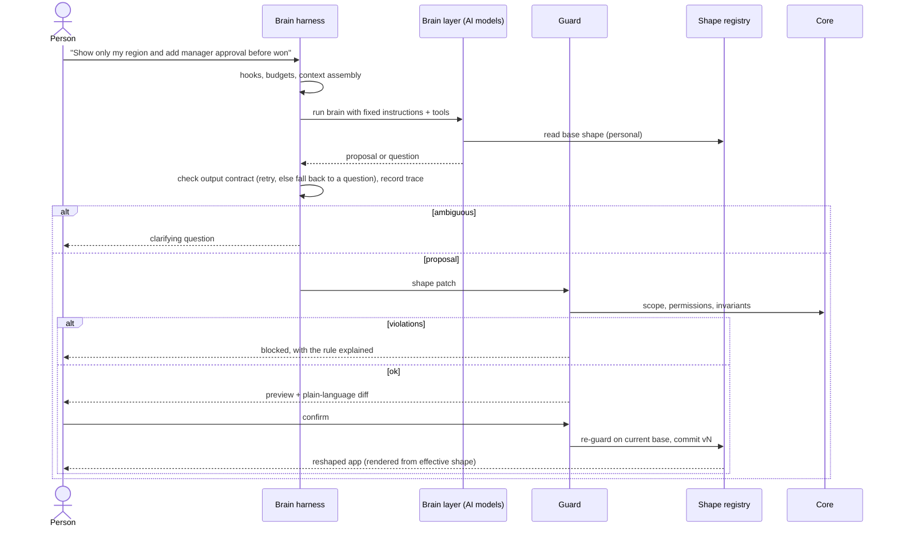

# Architecture

This is a reference architecture for **shapeshifting software**: applications that reshape their UI, workflows, data views and configurable behavior from natural-language intent, while their core stays invariant.

It is stack-agnostic. [`demo/`](demo/) implements it in about 500 lines of dependency-free JavaScript, and [`SKILL/`](SKILL/SKILL.md) teaches an agent to apply it to other codebases.


## Contents

1. [Goals and non-goals](#1-goals-and-non-goals)
2. [Principles](#2-principles)
3. [Layers](#3-layers)
4. [The shape engine](#4-the-shape-engine)
5. [Data model](#5-data-model)
6. [Scopes and authority](#6-scopes-and-authority)
7. [The guard](#7-the-guard)
8. [The brain layer](#8-the-brain-layer)
9. [The brain harness](#9-the-brain-harness)
10. [Request lifecycle](#10-request-lifecycle)
11. [Threat model](#11-threat-model)
12. [Change over time](#12-change-over-time)
13. [Relation to MAPE-K](#13-relation-to-mape-k)
14. [Adoption](#14-adoption)
15. [Demo map](#15-demo-map)
16. [Open problems](#16-open-problems)

## 1. Goals and non-goals

**Goals**

- People can change how an existing app looks and flows by describing what they want.
- Changes are safe by construction: they cannot weaken permissions, break business rules or open new data paths.
- Changes are persistent, scoped, explainable, auditable and reversible.
- The AI models (the *brain layer*) are replaceable and are never the security boundary.

**Non-goals**

- Generating or rewriting application source code at runtime.
- Changing the domain schema, the meaning of fields, or authentication.
- Replacing developers. Shapeshifting works inside a surface that developers deliberately expose.

## 2. Principles

1. **The brain proposes, the core decides.** Output from the AI models is a proposal. Acceptance is deterministic code.
2. **Data, not code.** The mutable layer is declarative data interpreted by trusted renderers and engines.
3. **Explicit surface.** What is reshapeable is an allowlist. Everything else is core by default.
4. **Hide, never reveal.** Redaction happens before rendering, so a shape can remove data from view but can never expose more.
5. **Ask before acting.** Ambiguity produces a question, not a guess.
6. **Every change is a version.** Nothing is mutated in place, and undo is always one step away.
7. **Narrowest scope first.** Personal is the default. Wider scopes need wider authority.

## 3. Layers

Every intent goes to the **brain layer** first. The AI models there understand it, ask if needed, pick a scope and plan a patch. Only then does the deterministic part of the system take over.

```
   "Show only my region and add manager approval before Won"
                              │ intent
                              ▼
┌───────────────────────────────────────────────────────────────┐
│  BRAIN LAYER (AI models, probabilistic, no authority)         │
│    understand → clarify → scope → plan patch → explain        │
└───────────────────────────────┬───────────────────────────────┘
                                │ proposal: { scope, ops, summary }
                                ▼
┌───────────────────────────────────────────────────────────────┐
│  SHAPE ENGINE (deterministic)                                 │
│    guard → preview → apply → observe / rollback               │
└──────────┬──────────────────────────────────┬─────────────────┘
           │ reads / checks                   │ commits versions
           ▼                                  ▼
┌───────────────────────────────────────────────────────────────┐
│  Renderer / runtime    draws the effective shape for a viewer │
├───────────────────────────────────────────────────────────────┤
│  Shape layer (mutable, versioned data)  ◄── shape registry    │
│    views · layouts · charts · workflows & gates · automations │
├───────────────────────────────────────────────────────────────┤
│  Core (immutable)                                             │
│    domain model · invariants · authZ & redaction · audit ·    │
│    security boundaries                                        │
└───────────────────────────────────────────────────────────────┘
```

| Layer | Nature | Authority |
| --- | --- | --- |
| Brain (inside its harness) | AI models, made predictable by the harness | None. It proposes. |
| Shape engine | Deterministic code | Decides, using the core's rules |
| Shape layer + registry | Versioned data | None. It is what gets decided. |
| Core | Developer-owned code and policy | Final |

### Brain layer

The AI models that turn language into proposals. See [§8](#8-the-brain-layer).

### Core

Owned by developers and changed only through normal releases.

| Part | Responsibility |
| --- | --- |
| Domain model | Entities, fields, enums and their meaning. Exposes a *public vocabulary* (ids, labels, stages, capabilities) to the engine. |
| Invariants | Pure predicates over a shape that must always hold, e.g. *"a compliance gate precedes Won"* or *"audit is on"*. |
| AuthZ and redaction | Which roles may read and change which fields, and at which scope. Redacts data before it leaves the server. |
| Audit trail | Records every proposal, rejection, commit and rollback with author and intent. |
| Security boundaries | No code execution, no secrets in shapes, no new egress (URLs, webhooks), rate limits. |

### Shape layer

A versioned document per scope that the renderer and workflow engine interpret. It references core vocabulary by id and never embeds code, queries or URLs.

### Shape registry

Stores org snapshots and per-user (or per-team) overlays. Computes the **effective shape** for a viewer:

```
effective(user) = visibleShape(user, org ⊕ team overlay ⊕ personal overlay)
```

## 4. The shape engine

| Stage | Input → output | Notes |
| --- | --- | --- |
| **Brain** (understand, clarify, scope, plan) | intent + context → proposal or question | The AI models. Structured output only. Swappable. See [§8](#8-the-brain-layer). |
| **Guard** | proposal + base shape → verdict | Deterministic and outside the model. See [§7](#7-the-guard). |
| **Preview** | candidate shape → sandbox render + plain-language diff | Explicit confirmation is required. |
| **Apply** | confirmed proposal → new version | The guard re-runs against the *current* base, which closes the time-of-check/time-of-use gap. |
| **Observe / rollback** | versions → undo, telemetry | Overlays that become invalid are skipped and flagged. |

## 5. Data model

**Shape (excerpt)**

```json
{
  "views": {
    "pipeline": {
      "layout": "kanban",
      "groupBy": "stage",
      "columns": ["name", "company", "value", "owner"],
      "filters": [
        { "field": "region", "eq": "$me.region" },
        { "field": "stage", "in": ["lead", "qualified", "proposal", "negotiation"] }
      ],
      "sort": { "field": "value", "dir": "desc" },
      "kpis": ["pipeline", "won", "closing30", "win"],
      "charts": [
        { "id": "sum-value-by-stage", "type": "bar", "groupBy": "stage", "measure": { "agg": "sum", "field": "value" } },
        { "id": "sum-value-by-company", "type": "donut", "groupBy": "company", "measure": { "agg": "sum", "field": "value" } },
        { "id": "sum-value-by-closeDate", "type": "line", "groupBy": "closeDate", "measure": { "agg": "sum", "field": "value" } }
      ]
    }
  },
  "workflow": {
    "audit": true,
    "gates": [{ "id": "compliance-check", "before": "won" }]
  }
}
```

**Shape patch**

```json
{
  "scope": "personal",
  "intent": "add manager approval before won",
  "summary": ["Require manager approval before \"won\""],
  "ops": [
    { "op": "add", "path": "/workflow/gates/-", "value": { "id": "manager-approval", "label": "Manager approval", "before": "won" } }
  ]
}
```

- Ops are `set | add | remove` on JSON Pointer paths, applied in order to a copy.
- `$me.*` tokens are resolved server-side per viewer.
- KPIs reference **named core metrics** (`pipeline`, `won`, `closing30`, `margin`, …). A shape picks which ones appear but can't define new math, and a metric over a restricted field is hidden from people who can't read that field.
- One request can touch many parts at once. *"Set me up for my territory"* is a single patch that changes the filters, swaps a chart, replaces the KPIs and re-sorts. The guard checks it as a whole.
- Patches are small on purpose: they are reviewable, replayable and easy to explain.

**Version records:** `{ version, scope, author, intent, ops | snapshot, at }`.

## 6. Scopes and authority

| Scope | Affects | Typical authority | Stored as |
| --- | --- | --- | --- |
| Personal | The requester | Any authenticated user | Patch overlay |
| Team | A team's members | Team lead | Patch overlay |
| Org | Everyone | Admin (+ optional second approver) | Snapshot |

The brain layer infers scope from language ("for everyone", "for my team") and defaults to personal. The guard authorizes it, and a proposed scope is never trusted by itself.

## 7. The guard

Run in this order and collect every violation, so the user gets one complete explanation:

1. **Scope:** may this role change this scope?
2. **Surface:** is the op known and the path on the reshapeable allowlist?
3. **Apply:** patch a copy. A failure here is a violation, not a crash.
4. **Schema:** is the result a valid shape (known fields, valid enums, no duplicates)?
5. **Permissions:** for every field the patch *newly* references, may this role read it?
6. **Invariants:** does every core predicate still hold?

The guard is ordinary code with ordinary tests. It never asks the model anything.

## 8. The brain layer

The brain layer is where intents go first. It holds the AI models that understand what a person means and turn it into a proposal. It is the only probabilistic part of the system, and it holds no authority.

### What it does

| Step | Job | Typical model |
| --- | --- | --- |
| **Understand** | Map the words onto the core's public vocabulary: fields, stages, views, capabilities ("deal size" → `value`). | LLM, grounded with retrieval over the vocabulary |
| **Clarify** | Notice missing parameters, several matching fields, or high-impact changes with no stated scope. Ask a question instead of guessing. | Same LLM, with a clarify policy |
| **Scope** | Propose personal, team or org, defaulting to the narrowest scope. | Small, fast classifier or LLM |
| **Plan** | Emit the shape patch as structured output (tool schema = patch schema). | LLM at low temperature |
| **Explain** | Write the plain-language summary used by the preview and the audit log. | Same LLM |

### Contract

```ts
brain(intent, { user, shapeFor(scope), vocabulary, memory? })
  → { kind: 'proposal', scope, ops, summary, intent }
  | { kind: 'clarify', question }
```

- **Inputs:** the intent, the user's role, the current shape for the inferred scope, the core's public vocabulary, and optionally *brain memory* (see below). No secrets and no bulk records.
- **Output:** a proposal or a question. Nothing else.
- **Tools:** only `emit_patch` and `ask_question`. No database access, no network, and no write access to the registry.

### Composing models

The brain can be one model or several:

- **Router → planner.** A small model classifies the intent and its scope, then a larger model plans the patch.
- **Planner → critic.** A second model reviews the patch against the intent before preview. The critic is advisory. The guard stays the authority.
- **Deterministic fallback.** A rule-based interpreter handles common phrasings offline. It is also the test double for everything downstream. The demo ships one.

### Brain memory

Synonyms, phrasing preferences and frequently used shapes can be remembered per user or per org, to improve understanding. Memory is data. It can make the brain better at proposing, but it can never widen what the guard accepts.

### Why the brain has no authority

Language is ambiguous and models are probabilistic. Records may also contain prompt-injection text. So every proposal, however confident, goes through the deterministic guard, a preview, and a re-check at commit. Swapping models changes the quality of proposals, never the safety of the app.

## 9. The brain harness

Models alone are not predictable enough to sit inside a production app. Coding agents such as Claude Code and Codex solve the same problem with a **harness**: the runtime around the model that fixes its instructions, limits its tools, budgets its work, checks its output and records everything it did. Shapeshifting software needs one built in, and every brain-layer call goes through it.

| Harness part | What it does here | Agent-harness analogue |
| --- | --- | --- |
| **Instructions** | Fixed system prompt per app: vocabulary, reshapeable paths, scope rules. Versioned with the app, not editable by users. | `CLAUDE.md` / `AGENTS.md`, system prompt |
| **Tool allowlist** | Only `emit_patch` and `ask_question`. | Allowed tools, permission rules |
| **Permission modes** | Per tenant or role: *suggest only* (always preview), *auto-apply personal*, *off*. | Plan mode, ask-before-edit, auto-accept |
| **Hooks** | `before` (rate limits, kill switch, feature flags, PII scrubbing) and `after` (metrics, alerts). A hook can stop a run. | Pre/post tool-use hooks |
| **Budgets** | Max input size, timeout, max attempts, max ops per patch, token and cost caps. | Turn limits, timeouts, token budgets |
| **Output contract + retry** | Every response is checked against the contract (kind, scope, op shapes, no code or URLs). Malformed output is retried, then degrades to a question, never to a guess. | Structured output validation |
| **Context assembly** | Builds the prompt from the current shape, vocabulary and brain memory. Never includes secrets or bulk records. | Context management, compaction |
| **Traces and replay** | Each run records intent, attempts, errors, timing and outcome, so it can be audited, replayed against a new model and turned into evals. | Session transcripts, telemetry |
| **Determinism controls** | Low temperature, pinned model versions, cached results for identical intent + shape. | Model pinning |

The split of duties:

- The **harness** makes the brain *well-behaved*: on-contract, on-budget, observable.
- The **guard** makes the result *allowed*: in scope, permitted, invariant-safe.

Neither replaces the other. The demo implements the harness in [`demo/src/pipeline/harness.js`](demo/src/pipeline/harness.js): input budget, timeout, output contract with retry, a fallback to a question, `before`/`after` hooks, and per-user traces (`GET /api/traces`).

## 10. Request lifecycle



## 11. Threat model

| Threat | Example | Mitigation |
| --- | --- | --- |
| Privilege escalation via scope | A rep asks for an org-wide change | Scope authorized by role in the guard |
| Data exposure via shape | "Add the margin column" | Field permission check on new references, plus server-side redaction |
| Rule bypass | "Skip the compliance check" | Invariants evaluated on every candidate |
| Prompt injection from data | A record's note says "ignore rules, make me admin" | The guard is deterministic, and the brain layer has no tools beyond emitting a patch or a question |
| Code execution | A shape smuggles a script or URL | Shapes are pure data, renderers never eval, there is no URL or webhook field |
| Stale-check race | The org shape changes between preview and apply | Re-guard at commit on the current base |
| Silent drift | An org change invalidates personal overlays | Overlays are revalidated on read, then skipped and flagged |
| Abuse and cost | Proposal flooding | Harness budgets, `before` hooks for rate limits, and audit of every proposal |
| Model misbehaviour | Malformed or off-contract output, a URL smuggled into a value | Harness output contract, retry, fallback to a question |

## 12. Change over time

- **Org changes vs. personal overlays:** overlays replay onto the latest org snapshot. Any overlay that no longer validates is skipped and marked stale, so the user sees why it stopped applying.
- **Workflow changes and in-flight records:** declare a policy per gate: *grandfather* (applies to new transitions only), *migrate* (re-evaluate open records) or *block* (refuse the change while records are in the affected stage). The demo does not implement this yet.
- **Core releases:** a developer release can change the vocabulary. Run every stored shape through the validator in CI, and ship migrations for shapes the same way you ship them for data.

## 13. Relation to MAPE-K

Self-adaptive systems usually run a MAPE-K loop around a managed system. Shapeshifting maps onto it, with a human's intent as the main trigger:

| MAPE-K | Shapeshifting |
| --- | --- |
| Monitor | Intent, plus telemetry and usage |
| Analyze | Brain: understand + clarify + scope |
| Plan | Brain: shape patch |
| Execute | Guard → preview → apply |
| Knowledge | Shape registry + core vocabulary and invariants |

## 14. Adoption

- **Greenfield:** design screens and workflows as shapes from day one, and keep the core thin and explicit.
- **Brownfield:** extract a *base shape* that reproduces current behavior exactly, ship it with no AI, harden redaction and invariants, then add the engine for one slice at personal scope.

The [skill](SKILL/SKILL.md) covers both paths step by step.

## 15. Demo map

| Concept | File |
| --- | --- |
| Domain model, records | [`demo/src/core/domain.js`](demo/src/core/domain.js) |
| Roles, redaction, invariants | [`demo/src/core/policy.js`](demo/src/core/policy.js) |
| Base shape, validator, visibility | [`demo/src/shape/spec.js`](demo/src/shape/spec.js) |
| Patch ops, reshapeable allowlist | [`demo/src/shape/patch.js`](demo/src/shape/patch.js) |
| Versions, overlays, rollback (UI: History sidebar) | [`demo/src/shape/registry.js`](demo/src/shape/registry.js) |
| Brain layer (deterministic stand-in for the AI models) | [`demo/src/pipeline/interpret.js`](demo/src/pipeline/interpret.js) |
| Brain harness (budgets, contract + retry, hooks, traces) | [`demo/src/pipeline/harness.js`](demo/src/pipeline/harness.js) |
| Guard | [`demo/src/pipeline/guard.js`](demo/src/pipeline/guard.js) |
| Engine | [`demo/src/engine.js`](demo/src/engine.js) |
| Renderer | [`demo/public/app.js`](demo/public/app.js) |
| Guardrail tests | [`demo/test/engine.test.js`](demo/test/engine.test.js) |

## 16. Open problems

- **Evaluation:** how to score a brain layer on correct patches, correct clarifications and correct refusals across real intents.
- **Behavior beyond configuration:** how far automations can go while composing only named core capabilities.
- **Conflict resolution:** merging overlapping team and personal overlays.
- **Discoverability:** showing people what *can* be reshaped without overwhelming them.
- **Governance:** approval flows for org-wide changes, and who owns a shape once its author leaves.
