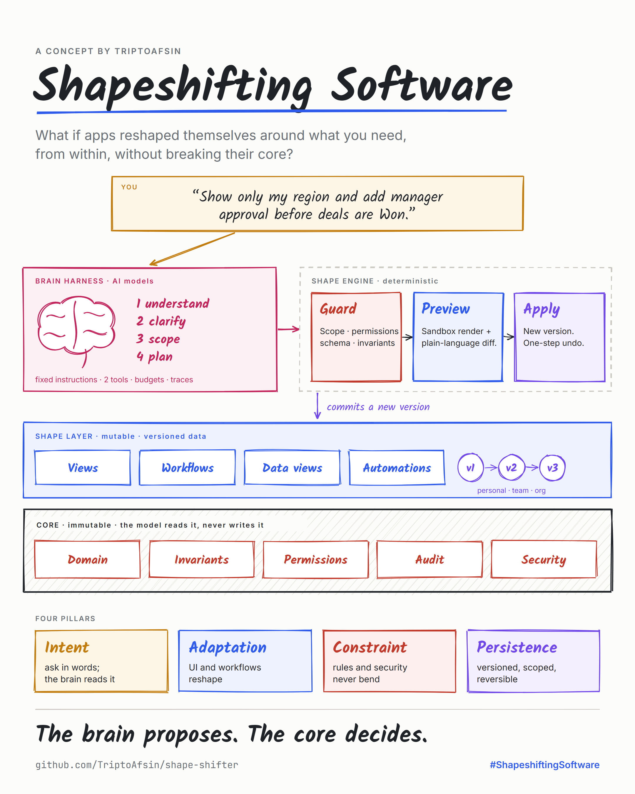
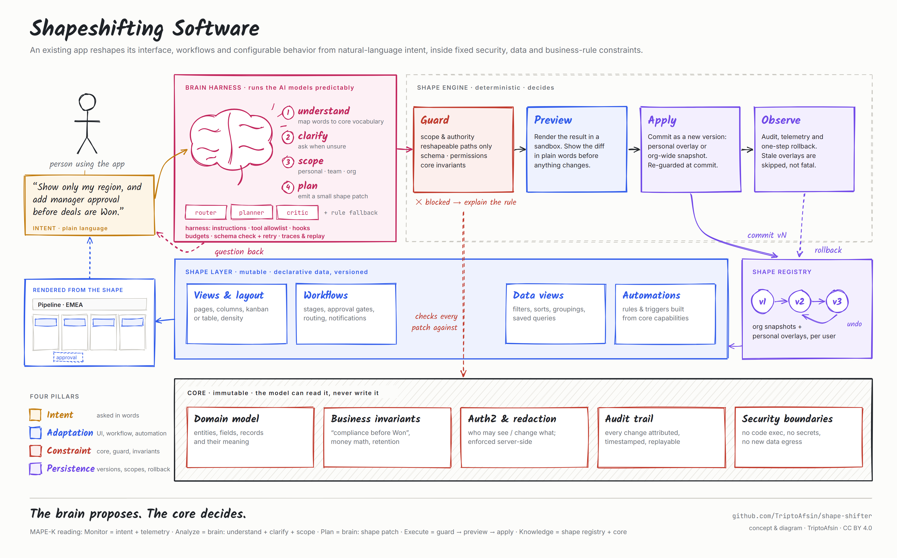

# Shapeshifting Software

<p align="center">
  
</p>

> Software that reshapes itself around what you need, from within, without giving up its core logic or its guardrails.

**Shapeshifting software** is an existing application that adapts its interface, workflows and configurable behavior from natural-language intent, within verifiable security, data and business-rule constraints.



## The idea

As a kid I was fascinated by shapeshifters in sci-fi movies, cartoons and TV shows: creatures that could change their form depending on the situation.

About five or six years ago, while I was still learning to code, I started wondering whether software could do the same. What if you could tell an application what you need, in your own language, and it reshaped itself to fit?

With the recent progress in AI, that no longer feels far-fetched. Picture a CRM where you change the page layout, the data flow, or how part of the system works just by describing it. The software adapts from within, and its core logic and security guardrails stay intact.

Vibe coding generates **new** applications from prompts. Shapeshifting software lets **existing** applications transform themselves from within.

|  | Vibe coding | Shapeshifting software |
| --- | --- | --- |
| Starting point | An empty repo | A running app with real users and data |
| Who asks | A builder | The person using the app |
| What changes | Source code | A declarative *shape* the app interprets |
| What stays fixed | Nothing in particular | Domain model, permissions, audit, security |
| Lifetime of a change | A new codebase | A versioned, scoped, reversible shape |

## Four pillars

| Pillar | Meaning |
| --- | --- |
| **Intent** | Users state requirements in natural language, and the system asks when it isn't sure. |
| **Adaptation** | UI, workflows, data views and automations are regenerated or recombined. |
| **Constraint** | A protected core model, authorization layer, invariants and validation that no prompt can bypass. |
| **Persistence** | Changes are versioned, scoped (personal, team or org), survive sessions and can be rolled back. They aren't throwaway chat screens. |

## How it works

The rule the design follows: **the brain proposes, the core decides.**

Every request goes to the **brain layer** first: the AI models that understand it, ask when it's unclear, pick a scope and plan a change. The brain runs inside a **harness**, much like the one that keeps Claude Code or Codex predictable. The harness fixes the instructions, allows only two tools, enforces budgets, checks every output, and records a trace. What leaves the brain is only ever a proposal.

1. **Brain:** the AI models turn intent into a *shape patch*, a small list of operations on declarative data. It is never code. If the request is ambiguous or high-impact, the brain asks before acting.
2. **Harness:** fixed instructions, a tool allowlist (`emit_patch`, `ask_question`), budgets, output checks with retry, hooks and traces. Misbehaving output degrades to a question, never to a guess.
3. **Guard:** deterministic checks outside the model cover scope and authority, reshapeable paths, schema, field permissions and core invariants.
4. **Preview:** the candidate shape is rendered in a sandbox, with a plain-language diff.
5. **Apply:** the patch is re-checked, then committed as a new version, either a personal overlay or an org snapshot.
6. **Observe and roll back:** audit, telemetry and one-step undo. Overlays made stale by later changes are skipped, not fatal.

The full design, including the [brain layer](ARCHITECTURE.md#8-the-brain-layer) and [brain harness](ARCHITECTURE.md#9-the-brain-harness), is in **[ARCHITECTURE.md](ARCHITECTURE.md)**.

## Try the demo


<sub>Higher quality: [`docs/assets/shapeshift-demo.mp4`](docs/assets/shapeshift-demo.mp4)</sub>

`demo/` is a tiny CRM that does all of the above with zero dependencies. **No AI key is needed:** its brain layer is a deterministic, rule-based stand-in that runs inside the same harness a real model would use. In a real product the request box takes anything; here, the phrasing it understands is a fixed set.

```bash
cd demo
npm start      # http://localhost:4173
npm test       # guardrail tests (node:test)
```

Requires Node 20+. Pick one of four **scenarios** from the dropdown (a rep makes it theirs, a manager adds a process step, an admin changes it for everyone, someone pushes past the guardrails) and tap a ready-made request, or type your own. Six guided missions tick off as you go. Try:

- *"Show only my region and chart value by company"*: a personal view, with a new chart that other users don't see
- *"Make it a donut"*: restyle the chart you just added
- *"Switch to a table and sort by close date, ascending"*
- *"Add manager approval before won"*: a new workflow gate
- *"Add an approval step"*: the system asks which stage
- *"Show the margin column"*: blocked for reps, allowed for admins
- *"Skip the compliance check for everyone"*: blocked by a core invariant, even for admins
- *"Chart average margin by region for everyone"*: an admin-only org chart that stays hidden from reps

Every change morphs into place (View Transitions), the KPIs and charts recompute live, and the engine strip shows each request moving Brain → Clarify → Guard → Preview → Apply. Harness traces for the current user are at `GET /api/traces`.

## Use the skill with your own app

[`SKILL/`](SKILL/SKILL.md) is an agent skill that walks a coding agent (Claude Code, Codex, Cursor and others) through applying this architecture to a **new** or **existing** codebase. It covers drawing the core boundary, designing the brain layer and its harness, the shape spec and patch language, building the guard, and testing the guardrails.

```bash
# Claude Code: personal skill
cp -r SKILL ~/.claude/skills/shapeshifting-software
# or per project
cp -r SKILL <your-project>/.claude/skills/shapeshifting-software
```

Then ask your agent something like *"make our dashboard shapeshifting"* or *"add natural-language customization to the orders list without touching permissions"*.

## Repository layout

```
.
├── README.md                 you are here
├── ARCHITECTURE.md           reference architecture
├── AGENTS.md                 instructions for AI coding agents working in this repo
├── SKILL/                    agent skill: apply shapeshifting to any codebase
│   ├── SKILL.md
│   └── references/           brain layer + harness, shape spec, guardrails, brownfield adoption
├── docs/
│   ├── assets/               architecture diagram, social poster, demo recording
│   └── diagram/              sources for both (HTML + rough.js)
└── demo/                     runnable reference implementation (Node, zero deps)
```

## Is this new?

Partly. The ingredients have decades of history, and this project builds on them:

- **Self-adaptive systems and autonomic computing.** Software that monitors itself and reconfigures at runtime, usually structured as a MAPE-K loop (Monitor, Analyze, Plan, Execute over shared Knowledge). It typically adapts to load, faults or environment rather than to a person saying what they want.
- **End-user development and natural-language programming.** Non-programmers shaping software through rules, examples or language. Ambiguity and incorrect implementations remain the central difficulties.
- **Malleable software.** Tools users can reshape with minimal friction (Ink & Switch, Geoffrey Litt and others).
- **Generative UI.** LLMs that generate interfaces at runtime (Google Research's Generative UI, the A2UI protocol).

What this project focuses on is the **product-level synthesis**: a production application whose UI, workflows, data views and some business behavior can be safely and persistently reshaped through natural-language intent, while domain rules, permissions, audit trails and security boundaries stay invariant. For technical framing, you can also call it an *intent-driven malleable software system* or an *LLM-mediated self-adaptive application platform*.

## Open questions

- Can *this* user change *this* workflow, and who approves org-wide changes?
- Does a new rule violate data permissions or compliance policy?
- What happens to in-flight records when a process changes?
- Where is the line between personal preference and structural change?
- How do you evaluate a brain layer for correct patches, correct questions and correct refusals?

Discussion and ideas are welcome in [Issues](https://github.com/TriptoAfsin/shape-shifter/issues).

## Roadmap

- [x] Concept, reference architecture, diagram
- [x] Agent skill for new and existing codebases
- [x] Zero-dependency demo with guardrail tests
- [x] Brain harness: budgets, output contract with retry, hooks, traces
- [ ] Model-backed brain (behind the same harness) with structured output and an eval set
- [ ] Team scope and two-person approval for org changes
- [ ] Automations as a reshapeable surface (named core capabilities only)
- [ ] Migration policy for in-flight records when workflows change

## Further reading

- Ink & Switch, [*Malleable software: Restoring user agency in a world of locked-down apps*](https://www.inkandswitch.com/essay/malleable-software/) (2025)
- Geoffrey Litt, [*Malleable software in the age of LLMs*](https://www.geoffreylitt.com/2023/03/25/llm-end-user-programming) (2023)
- Li, Zhang, Li, Weyns, Jin, Tei, [*Generative AI for Self-Adaptive Systems: State of the Art and Research Roadmap*](https://arxiv.org/abs/2512.04680) (ACM TAAS, 2025)
- Robinson et al., [*Requirements are All You Need: The Final Frontier for End-User Software Engineering*](https://arxiv.org/abs/2405.13708) (2024)
- Google Research, [*Generative UI: A rich, custom, visual interactive user experience for any prompt*](https://research.google/blog/generative-ui-a-rich-custom-visual-interactive-user-experience-for-any-prompt/)
- Google, [*Introducing A2UI: An open project for agent-driven interfaces*](https://developers.googleblog.com/introducing-a2ui-an-open-project-for-agent-driven-interfaces/) (2025)
- [*Automated Functional Testing for Malleable Mobile Application Driven from User Intent*](https://arxiv.org/abs/2604.02079) (2026)
- David Shapiro, [*Welcome to the Era of Polymorphic Applications*](https://medium.com/@dave-shap/welcome-to-the-era-of-polymorphic-applications-86fb00217951)
- Kephart & Chess, *The Vision of Autonomic Computing*, IEEE Computer (2003)

## Author

**TriptoAfsin**: concept, term, architecture and skill. [github.com/TriptoAfsin](https://github.com/TriptoAfsin)

If you build on this idea, a link back is appreciated:

```
TriptoAfsin. "Shapeshifting Software." https://github.com/TriptoAfsin/shape-shifter
```

## License

[CC BY 4.0](LICENSE). Share and adapt freely, with attribution.
